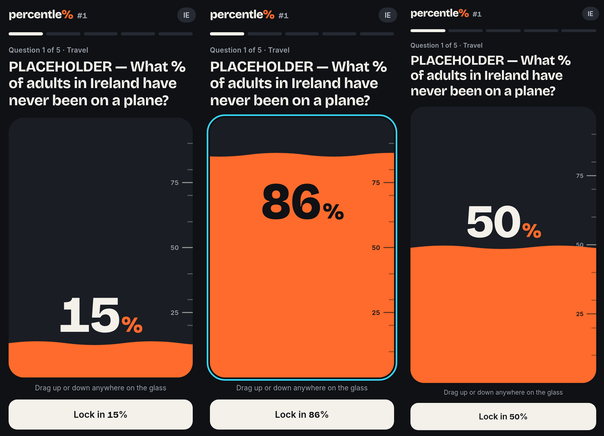

# Few Clues  ·  fewclues.app

A daily place-guessing game. Five rounds a day: each starts with the hardest of four hand-written clues about a country, and every wrong guess unlocks an easier one. The fewer clues you need, the more points: 100, 60, 30 or 10. Then see the fact behind it, how everyone else did, and how you did against friends in a league.

> Formerly “Percentle”. The earlier percentage game is in git history (`main`), and the Read the Room prototype is parked on the `read-the-room` branch.

- **Frontend:** React 19 + Vite + TypeScript, CSS modules. Uses `motion`, `@number-flow/react`, `web-haptics`, and `canvas-confetti` (lazy-loaded). Fonts (Bricolage Grotesque, Inter) are self-hosted. There are no runtime CDNs and no trackers.
- **Backend:** one Node service (Hono + better-sqlite3) that also serves the built frontend.
- **Shipping:** one Docker container. Idle RAM is about 21 MiB.



## Run locally

Requires Node 20+.

```sh
npm install
ALLOW_DRAFTS=1 DEV_DATE=2026-12-01 PERCENTILE_MIN_PLAYERS=2 npm run dev
# web: http://localhost:5173  (proxies /api to :8787)
```

- `ALLOW_DRAFTS=1`: draft questions are playable. The seed file is all drafts.
- `DEV_DATE=YYYY-MM-DD`: pins "today" to one puzzle date. For testing only.
- `PERCENTILE_MIN_PLAYERS=2`: shows "Top X%" and "closer than X%" with just two test players. The default is 20.

Other commands:

```sh
npm test                  # vitest: scoring, DST rollover, share text, validation, API, leagues, CSP
npm run typecheck
npm run build && npm start   # production build on :8787
```

## Adding questions

Questions live in `content/questions.json`. Each entry looks like this:

```json
{
  "id": "ie-0016", "date": "2026-12-04", "order": 1, "edition": "ie",
  "category": "Travel",
  "question": "What % of adults in Ireland have never been on a plane?",
  "answer": 9, "year": 2024,
  "source_name": "CSO", "source_url": "https://…",
  "nugget": "One or two sentences of context.",
  "comparisons": [{ "label": "EU average", "value": 15 }],
  "difficulty": "easy", "status": "approved"
}
```

- `category` is optional. It is shown as "Question 3 of 5 · Travel".
- `comparisons` holds 0–5 items.
- Only `approved` questions are served.
- Every scheduled date needs exactly 5 approved questions, with orders 1–5.
- The shipped 15 questions (1–3 December) use real figures from CSO Census 2022 and Eurostat. Each one was checked against the linked source page. They are still `draft`: review them, then set `status` to `approved` for the beta.
- The validator refuses an approved question that contains the word PLACEHOLDER.

## Validating content

```sh
npm run validate-content                  # strict: approved only
npm run validate-content -- --allow-drafts
```

The validator checks:
- the schema
- duplicate IDs
- that answers and comparison values are 0–100 with at most 1 decimal place
- that each scheduled date has exactly 5 approved questions with orders 1–5

It warns about any of the next 14 days that have no questions. It exits 1 on errors; warnings alone still pass.

The running server re-reads the file within 30 s when it changes. A bad edit is logged and the previous good content stays live.

## Docker

```sh
docker compose up -d --build
```

- The SQLite database lives in the named volume `fewclues-data`.
- `./content` is mounted read-only, so you can add questions without rebuilding.
- The port is bound to `127.0.0.1:8787` only.
- The image build runs the validator and the full test suite.

Configuration (environment variables):

| Var | Default | |
|---|---|---|
| `SITE_URL` | `https://fewclues.app` | Used for og:image and og:url. The share text uses its host. |
| `LAUNCH_DATE` | `2026-12-01` | Puzzle #1. Earlier dates show "Coming soon". |
| `EDITION` | `ie` | |
| `PERCENTILE_MIN_PLAYERS` | `20` | |
| `RATE_LIMIT_PER_MINUTE` | `60` | All POSTs, per IP. |
| `LEAGUE_CREATES_PER_HOUR` / `LEAGUE_JOINS_PER_HOUR` | `10` / `30` | Per IP. |
| `ROLLOVER_GRACE_MINUTES` | `60` | Yesterday's puzzle still accepts guesses this long after midnight. |

The health check is at `GET /api/health`.

## Cloudflare Tunnel

The container only listens on localhost, so the tunnel is the only way in. That is also why the server can trust `CF-Connecting-IP` for rate limiting.

```sh
cloudflared tunnel create fewclues
cloudflared tunnel route dns fewclues fewclues.app
```

`~/.cloudflared/config.yml`:

```yaml
tunnel: fewclues
credentials-file: /home/<you>/.cloudflared/<tunnel-id>.json
ingress:
  - hostname: fewclues.app
    service: http://127.0.0.1:8787
  - service: http_status:404
```

Run it with `cloudflared tunnel run fewclues`, or install it as a service. If cloudflared runs in Docker, put it on the same Docker network and point it at `http://fewclues:8787`, rather than publishing the port.

## API

| | |
|---|---|
| `GET /api/today` | Header `X-Player-Id`. Returns today's question texts (never answers), plus this player's reveals and completion so far. |
| `POST /api/guess` | `{player_id, question_id, guess}`. Records one guess per question per player. Returns the reveal (answer, source, nugget, comparisons, histogram, closer-than %). After the 5th guess it also returns the completion (total, percentile, gap of the day). |
| `POST /api/leagues` | `{player_id, name, display_name}` |
| `POST /api/leagues/join` | `{player_id, code, display_name}`. Max 50 members per league; a player can be in up to 20 leagues. |
| `GET /api/leagues` | My leagues. |
| `GET /api/leagues/invite/:code` | League name and size, for the join sheet. |
| `GET /api/leagues/:id/standings?period=day\|week` | Scores and closeness blocks. Head-to-head only appears once you've finished today. Weeks run Monday–Sunday, Europe/Dublin time. |

## Decisions

**Game rules**
- **Puzzle numbering.** Launch day is #1.
- **Bullseye.** The slider moves in whole numbers but answers can have one decimal place, so off by ≤ 0.5 counts as a bullseye (100 points).
- **Percentile.** This is the share of *other* finishers with a strictly lower total. "Top X%" is 100 minus that, and is hidden under 20 finishers. "Closer than X%" on each reveal uses the same threshold.
- **Verdicts.** Bullseye; Close call (off by ≤3); Not bad (≤20); Way off (>20). The closeness colours use the same thresholds as the share blocks (≤3, ≤10, ≤20, >20).
- **Gap of the day.** The question with the highest share of players off by more than 10.

**Privacy and security**
- **Fonts are self-hosted, not loaded from Google Fonts.** They look identical, but this keeps the "no trackers" promise and makes no requests to Google.
- **Strict CSP.**
  - `script-src 'self'`.
  - `style-src 'self'` plus a per-request nonce, which NumberFlow puts on its shadow-DOM `<style>`.
  - Confetti runs without its blob-URL worker, so it needs no CSP exception.

**Motion and feel**
- **Glass performance.** Each frame moves only transforms, driven by motion values; React re-renders once per whole percent, and only the number does. NumberFlow's roll animation is off while a finger is down, because it forces a layout on every change. Measured at 4× CPU throttle: 60 fps, p95 frame time 16.7 ms, no frames over 20 ms.
- **Haptics are best-effort.**
  - web-haptics `light` fires at every 10% crossed, and `heavy` at 0, 50 and 100.
  - Lock-in gets `heavy`, and a bullseye gets `success`.
  - Nothing fires before the first tap, since browsers block that anyway.
  - **iPhone:** every iOS browser (Safari, Chrome, Firefox) is WebKit, which has no Vibration API. web-haptics' iOS 18 switch trick only works inside a tap (click/pointerup), so on iPhone you feel the release of the glass and Lock in. The 10% ticks during a drag can't work there.
- **Head-to-head copy uses no pronouns.** It says "Expect to hear about it" instead of "She's…".

**Accessibility**
- **Two of the brief's colours are low-contrast graphics.** The ≤20 closeness block (#3A3F49) and the "other" comparison bars (#4A505C) fall below the 3:1 non-text contrast guideline. Each always has text beside it (points or "Off N", values) plus aria labels. All text passes AA.

## Ideas for v2

- **Abuse and robustness**
  - Make it harder to flood the histograms with fresh player IDs, e.g. by requiring a short proof-of-work per new ID.
  - Add a server-side "restore my player ID" code, so streaks survive cleared storage.
- **Data**
  - Add an admin preview page for curators, plus a CI job that runs `validate-content` on every push.
  - Keep a per-question answer history, so a corrected answer doesn't change totals that have already been stored.
- **Leagues**
  - Let a player leave a league or rename it.
  - Show a weekly winner, and give the league creator moderation controls.
